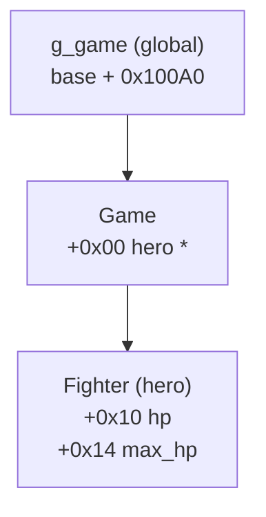

# minimal_cheat

A small external cheat for `game.exe` (Windows, 64-bit). It finds the running game, sets the hero's HP to 99,999, and keeps it full until the game exits.

## How it works


Memory layout the cheat relies on:



## Build

```sh
# Only before the first build
$ cargo install cargo-xwin

# Cross compile the executable under linux
$ make build
```

This runs a build using `cargo xwin`. Output: `target/x86_64-pc-windows-msvc/release/game_cheat_minimal.exe`.

## Run

1. Start `game.exe`.
2. Start the cheat. It waits until the game is running, then attaches.
3. Once the hero exists, its HP is set and kept at max. The cheat exits when the game does.

The cheat needs enough privilege to open the game process.

## Notes

- The offsets are fixed for one build of `game.exe`. A new game version needs new values in `src/offsets.rs`.
